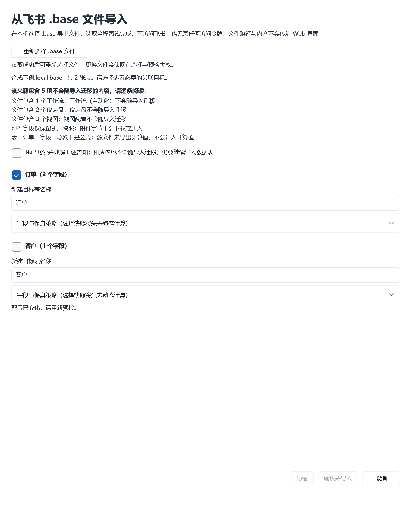

# 多维表格导入

导入管理提供两类本地来源。CSV 与 Excel（`.xlsx` / `.xlsm`，不支持旧版 `.xls`）沿用既有文件选择与预览流程，导入**既有目标表**：单次应用为一次原子提交，上限 1000 行；Excel 只读取单个工作表（默认首个或明确指定的工作表），不做整工作簿迁移；`.xlsm` 中的宏与任何文件中的脚本、链接均不会执行。

飞书多维表格通过「导入管理 → 飞书 .base 文件」进入：点击后 Host 原生窗口直接打开系统文件选择器，无需访问令牌或云凭据，随后选表、设置字段策略、预检并确认；此路径**只新建目标表**。进度、取消与结果复用统一任务记录。在线飞书 / WPS 云端读取已停用：新的云端来源请求会被 Host 明确拒绝（不会误路由到文件导入），历史中的 feishu / wps 迁移回执仍可正常查看。

## 飞书本地 `.base` 文件

选择文件后，Host 在内存中读取并冻结导出快照，后续预检和导入复用这份内容，不再次读取文件，也不访问飞书。文件路径不传给 Web 界面。此入口识别当前已验证的 `schemaVersion=5`、`structVersion=1` 导出结构；损坏或超限文件、重复标识及不支持的结构会拒绝读取。解析限额：单文件 32 MiB、解压总量 64 MiB、100 表、每表 512 字段、每表 50 000 条记录；Go 预检另有**所选表合计** 50 000 条及序列化快照 32 MiB 的容量上限。这些是拒绝读取的安全边界，不代表已验证的迁移资格规模。读取成功后可重新选择文件；更换文件会使既有选表、字段策略与预检全部失效，必须重新预检。

### 字段能力矩阵

| 来源字段（已观察 type/fieldUIType） | 策略 | 说明与证据 |
| --- | --- | --- |
| 文本（1/Text，纯文本段） | 原生迁移 | 拼接为单个文本值；富文本/混合段整列转 JSON 快照（`ReadFileAsync_MapsObservedShapesToFrozenSnapshot`、`ReadFileAsync_OptionalMembersAbsent_StillSucceeds`） |
| 数值（2/Number、Currency） | 原生迁移 | 保留 JSON 原始数字文本；精度不可表示时 Go 预检阻断并要求精确文本快照 |
| 单选（3/SingleSelect） | 原生迁移 | 选项按 id/name 身份映射；重复或缺失 id 拒绝读取 |
| 日期（5/DateTime） | 原生迁移 | 毫秒时间戳转 UTC ISO；越界拒绝 |
| 链接（15/Url，单段且文字=地址） | 原生迁移 | 其他形状整列转 JSON 快照并告知 |
| 人员（11/User） | JSON 快照（非原生） | 仅保留 userId 与姓名等展示信息；头像等元数据丢弃且提前告知 |
| 附件（17/Attachment） | JSON 快照 | 已观察容器不含附件字节；官方可另导附件 ZIP，本期不支持 ZIP |
| 公式（20/Formula）、查找（19/Lookup） | JSON 快照 | 仅迁移已导出的缓存值，缺失结果明确告知并留空 |
| 系统时间（1002/ModifiedTime） | JSON 快照 | — |
| 其他（如多选、复选、关联及未知 pair） | JSON 快照 / 跳过 | 仓库内尚无真实导出形状证据，不做原生映射，不照搬在线 API 码 |

`0`、`false`、`null`、前导零与精度不会静默损失——这一保证由具体策略承载：普通值按原样冻结或写入（`TestPreviewValueSemanticsKeepZeroFalseNullEmptyAndLeadingZeros`），超出数值精度或无法映射的结构会阻断并要求显式精确文本 / JSON 快照或跳过，而不是静默转换。

视图、仪表盘、自动化与权限不迁移；已识别的视图、仪表盘和自动化计数会在预检前披露，勾选确认后才能预检。

## 预检、保真与回执

- 目标表名、选表、字段策略、快照类型、反向字段名或告知确认变化都会使旧预检失效，必须重新预检后才能确认；有损内容未获显式确认前不会提交。
- 值快照可选择保持类型、精确文本或 JSON；快照不保留动态计算能力。
- 源端只读；本地写入复用既有导入内核与 Go/PocketBase 权威。取消、部分提交及结果未知以任务回执为准，不自动删除已创建的目标表。
- 预检与确认时的来源告知（含截断说明）作为 `notices` 随来源快照进入 Go 并持久化到迁移回执：单条 ≤512 字符、条数 ≤256、JSON 编码总量 ≤128 KiB，超出保留前缀并附显式截断标记；告知按来源文件范围持久化（含未选表），历史展开的「来源文件说明」如实标注。

## 验证边界

`.xlsm` 兼容由无宏的 macroEnabled OpenXML 工作簿（`[Content_Types].xml` 主部件为 macroEnabled 类型，不含 VBA project）经实际导入读取路径的合成回归覆盖：值与同名 `.xlsx` 完全一致，该样本仅验证值读取，不覆盖真实 VBA project 兼容性；这是读取层回归，不代表已验证真实桌面 `.xlsm` 全流程，也不新增宏能力。

本地 `.base` 解析、窗口确认边界、Go 持久链与 Web 历史投影均有合成回归覆盖；它们不能替代真实平台导出矩阵验证。多选、复选、关联等字段映射仍待仓库内出现真实导出形状证据后再扩展。

